# simple-search

simple-search 是一个本机搜索工具：按一下热键弹出搜索框，输入的同时就出结果。它能搜文件名、文件里的文字（PDF、Office、截图）、AI 历史对话和浏览器书签。所有索引都只保存在你自己的电脑上。

它同时是一个 AI Skill：装进 Claude 或 Codex 后，直接说「帮我找上周改过的 Excel」就行，不用记语法。



## 能搜什么

| 分类 | 例子 | 回车后 |
| --- | --- | --- |
| 文件和文件夹 | `bxdj`（拼音首字母）、`ext:pdf dm:month`、`in:~/Downloads size:>100mb` | 打开文件；⌘↩ 在访达中显示 |
| 文件内容 | `content:削峰填谷`、`content:发票 ext:pdf` | 打开文件，结果附带命中片段 |
| 截图 / 照片里的文字和画面 | `content:token kind:image`、`content:猫` | 打开图片 |
| AI 对话 | Claude Code（命令行和桌面端）、Codex、WorkBuddy | 打开原会话；部分来源支持 ⌘↩ 在终端里继续 |
| 浏览器书签 | Chrome、Edge、Brave，书签文件夹的名字也能搜 | 用原来的浏览器打开 |
| 自定义网址 | 自己设置关键词，可打开固定网址或站内搜索 | 用系统默认浏览器打开 |

拼音支持多音字：「重庆」用 `cq`、`zq` 都能搜到。查询为空时，每个分类显示最近的内容。

## 为什么快

<p align="center">
  
</p>

- **窗口和索引一直在线。** 原生应用常驻菜单栏，负责接收快捷键，并启动后台搜索服务（`simple-search serve`）。文件名索引常驻内存，输入变化时，窗口直接向该服务发起查询。
- **文件名按列连续存放。** 所有名称拼成一整段文本，匹配时用 C 实现的字符串查找扫一遍，不为每个文件创建对象。
- **按目录先序排列。** 任一文件夹的全部内容是一段连续区间，所以「只搜某个文件夹」几乎不花时间。
- **增量更新。** 没变化的文件夹和对话记录直接沿用上次的结果。
- **结果先核实再显示。** 刚删掉的文件不会出现在结果里；索引过期时先用旧索引马上作答，同时在后台刷新。

上游项目的基准测试使用一份 155,030 项的真实家目录索引（Linux 测试机，Python 3.10，每条查询取 3 次中最快一次）：

| 操作 | 耗时 |
| --- | ---: |
| 常驻进程加载索引 | 0.11 s |
| 普通关键词 `north` | 3.1 ms |
| 拼音首字母，4 个字母 | 2.8 ms |
| 中文关键词，2 个字 | 1.9 ms |
| 类型 + 日期 `kind:image dm:week` | 3.9 ms |
| 带排除 `readme !node_modules` | 5.0 ms |
| 单个字母（命中约 9.8 万项） | 110 ms |

在 50 万项的生成数据上：首次建索引 7.7 秒，没有变化时再更新一次 2.2 秒。

## 安装

在项目根目录运行。macOS 搜索窗口需要 macOS 11 或更新版本、Python 3.8+ 和 Xcode 命令行工具。

```sh
./install.sh                 # 安装 simple-search 命令到 ~/.local/bin
simple-search index          # 建立文件名索引
simple-search app install    # 编译并启动搜索窗口
```

按 **⌥ 空格** 打开搜索窗口，也可以点菜单栏图标。命令行用法如下。

```sh
simple-search 报告 ext:pdf dm:month                # 搜索最近一个月的 PDF 报告
simple-search content index                       # 建立文件内容索引
simple-search content:发票                         # 搜索正文里的发票
simple-search topics 削峰填谷                       # 搜索本机 AI 对话
```

### 本地打包

在项目根目录运行 `./scripts/release.sh`，生成 `dist/simple-search-macOS.zip`。解压后可把 `simple-search.app` 拖进「应用程序」。应用在首次运行时安装命令和程序文件。

### 作为 AI Skill 安装

将 `skills/simple-search/` 目录复制到 Claude 或 Codex 的 skills 目录。

## 窗口快捷键

| 按键 | 作用 |
| --- | --- |
| Option + 空格 | 打开 / 关闭窗口（默认，可在菜单栏 →「更改快捷键…」修改） |
| ↑ ↓ | 选择结果 |
| ← → | 切换分类（搜索框为空，或光标在开头 / 末尾时） |
| ↩ / ⌘↩ | 打开 / 在访达中显示（AI 对话：在终端继续） |
| ⌘C / ⌥⌘C | 拷贝路径 / 拷贝名称 |
| ⌘Y | Quick Look 预览 |
| ⌘1 … ⌘9 | 直接跳到某个分类 |
| ⌘R | 立即更新索引 |

全局快捷键支持一个或多个 Control、Option、Command、Shift 加一个普通键，也支持双击其中一个修饰键。保存前会检查可检测的冲突，保存后立即生效。启动时发现冲突会直接弹出修改窗口。双击需要 macOS 的「输入监控」权限。其他应用的共享注册和按键监听可能无法检测。

## 搜索语法

| 输入 | 意思 |
| --- | --- |
| `foo bar` / `foo \| bar` | 同时包含 / 包含其一 |
| `readme !node_modules` | 排除：名称或任一上级目录含 node_modules |
| `*.png`、`IMG_????.jpg` | 通配符 |
| `in:~/Desktop`、`~/Desktop/ png` | 只在某个目录下找 |
| `ext:pdf;docx`、`kind:image` | 按扩展名 / 类型（folder app doc image video audio code archive） |
| `size:>10mb`、`dm:week`、`dm:2026-01..2026-03` | 按大小 / 修改时间 |
| `regex:^IMG_\d+`、`case:README`、`fuzzy:rdme` | 正则 / 区分大小写 / 模糊匹配 |
| `content:"付款 条件"` | 文件内容 |

完整说明见 `simple-search syntax`。从终端复制来的路径可以直接粘贴：`file://` 链接、带引号或转义的路径、末尾带 `:行:列` 的都能识别。

## 自定义网址

从菜单栏打开「自定义网址…」，点「新增…」并填写标题、关键词和 HTTP(S) 网址。保存后，在搜索窗口切到「网址」（⌘9）可查看已配置的条目。在「网址」或「全部」输入关键词，按回车即可用系统默认浏览器打开。

| 关键词 | 网址 | 搜索框输入 |
| --- | --- | --- |
| `gh` | `https://github.com/` | `gh` |
| `ghs` | `https://github.com/search?q={query}` | `ghs Swift 教程` |

关键词必须是单个词，忽略大小写。输入关键词前缀即可看到候选，完整匹配排在首位。选中固定网址后可直接打开，按 ⌘C 可拷贝链接。带 `{query}` 的网址需要输入完整关键词，再加空格和搜索词。中文和特殊字符会自动编码。

## 使用 SOP

日常怎么用、怎么维护、出了问题怎么查，见 [docs/SOP.md](./docs/SOP.md)。最常用的几条：

| 什么时候 | 做什么 |
| --- | --- |
| 第一次用 | `./install.sh` → `simple-search index` → `simple-search app install` → `simple-search content index` |
| 刚建的文件搜不到 | `simple-search update`，或在窗口里按 ⌘R |
| 新放了一批文档或截图 | `simple-search content index`（只处理新增和改过的文件） |
| 插上移动硬盘 | `simple-search index --volumes`，之后拔掉也能搜到（结果标「离线」） |
| 检查哪里不正常 | `simple-search doctor` |

## 外部依赖

核心功能只用 Python 标准库和系统自带工具，下面这些是可选的：

| 依赖 | 用途 | 没有时 |
| --- | --- | --- |
| Python 3.8+ | 必需 | — |
| Xcode 命令行工具（`xcode-select --install`） | 编译搜索窗口；macOS 自带的文字识别和 PDF 读取 | 只能用命令行；改用下面两项 |
| `pdftotext`（poppler） | 读取 PDF 文字 | macOS 用 PDFKit 代替 |
| `tesseract`（中文需 `chi_sim`） | 图片文字识别 | macOS 用系统的 Vision 代替 |
| Spotlight、`textutil`、`qlmanage` | 补充内容结果、读取 doc/rtf、预览 | macOS 自带 |

数据来源都是只读的，包括 Claude Code（`~/.claude`）、Codex（`~/.codex`）、WorkBuddy（`~/.workbuddy`）的本地记录和 Chromium 系浏览器的 `Bookmarks` 文件。

## 隐私

- 所有索引都在本机 `~/.simple-search/`，不上传任何内容，不调用任何模型。
- 对话和书签只读，不修改原始数据。
- 文件只会被移到废纸篓（可以恢复），不会被永久删除。

## 限制

- 搜索窗口需要 macOS；Linux 上可用命令行检索和查看对话。
- 不支持网络卷。外置磁盘需要先插上建过索引，拔掉后才能继续搜到。
- 文件名索引按设定的间隔更新（默认 30 分钟，搜索时会在后台刷新），不是实时监听。
- 只收录保存在本机的 AI 对话；网页版聊天、云端会话不在范围内。

## 目录结构

| 路径 | 内容 |
| --- | --- |
| `skills/simple-search/SKILL.md` | AI Skill 说明 |
| `skills/simple-search/scripts/simple_search/` | 索引、查询、内容提取、对话、书签、常驻进程 |
| `skills/simple-search/scripts/helper/` | macOS 搜索窗口（Swift / AppKit）和图像识别组件 |
| `skills/simple-search/tests/` | 自测：`python3 -I skills/simple-search/tests/test_simple_search.py` |
| `docs/SOP.md` | 使用 SOP |
| `install.sh` | 从源码安装 `simple-search` 命令 |
| `scripts/release.sh` | 构建本地 macOS 安装包 `simple-search-macOS.zip` |

## License

[MIT](./LICENSE)
